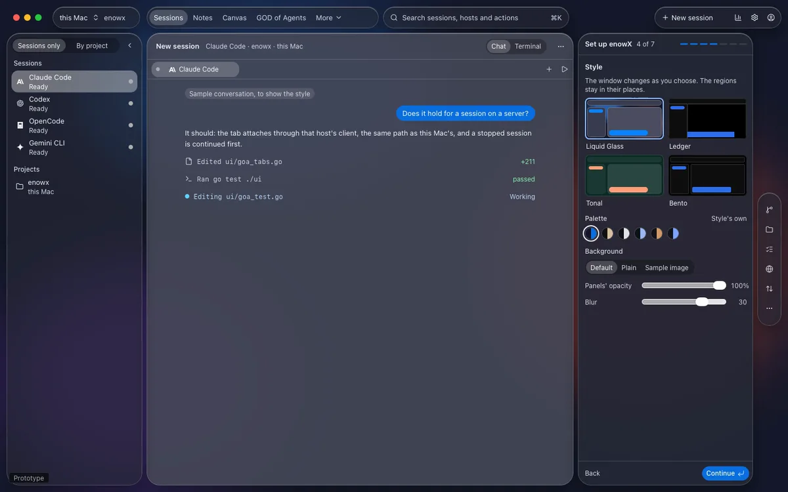
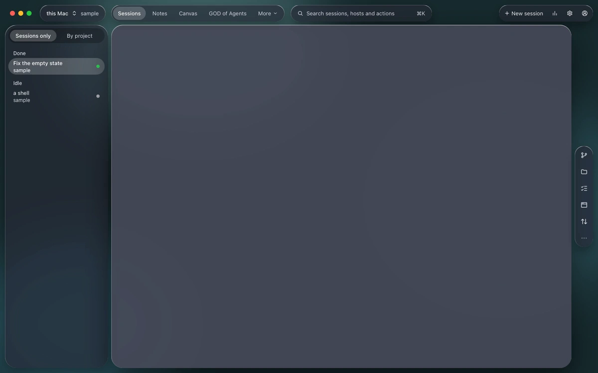
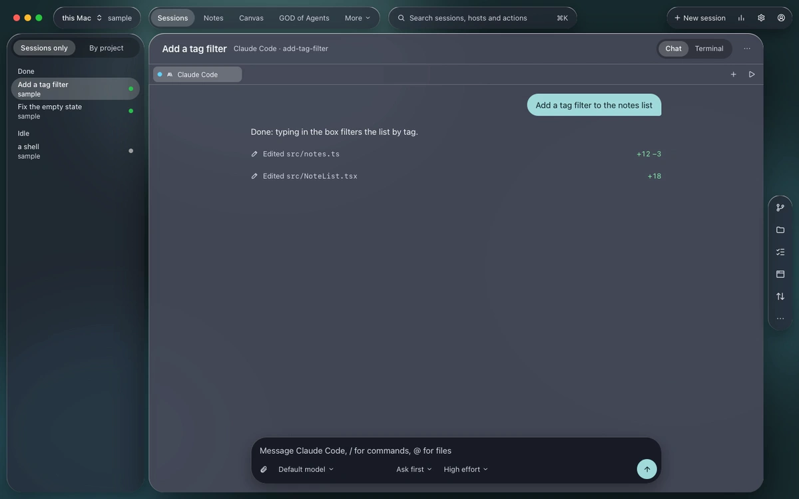
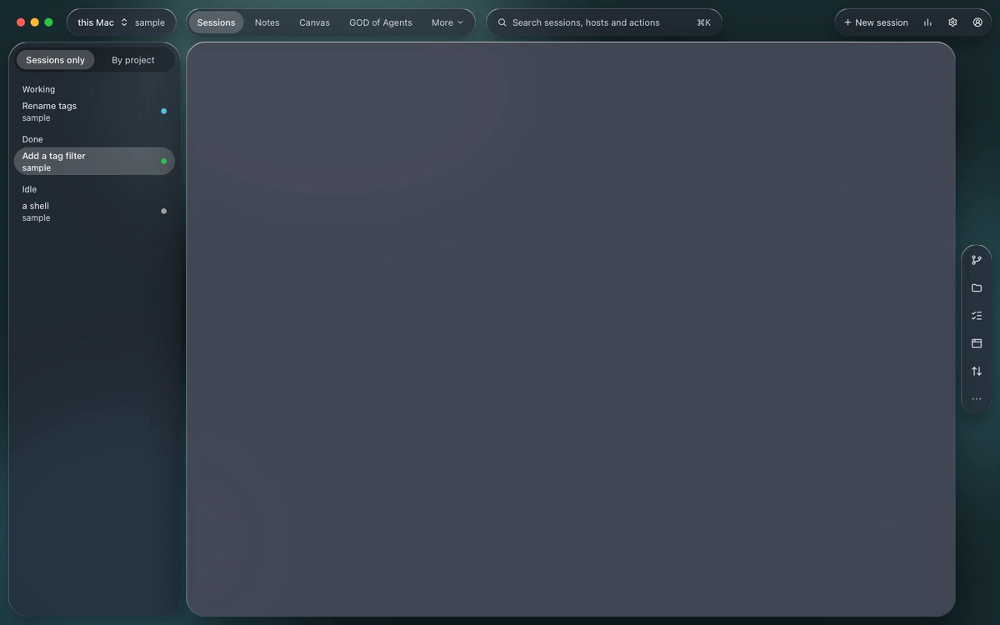
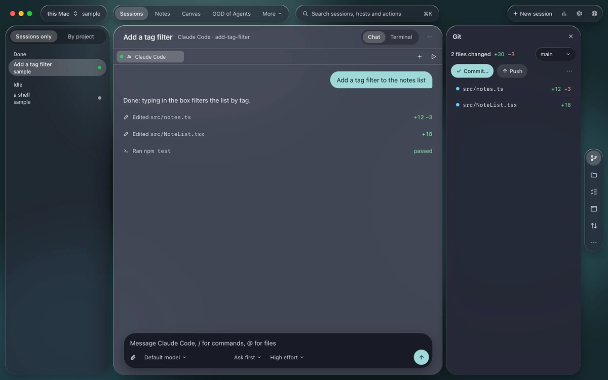
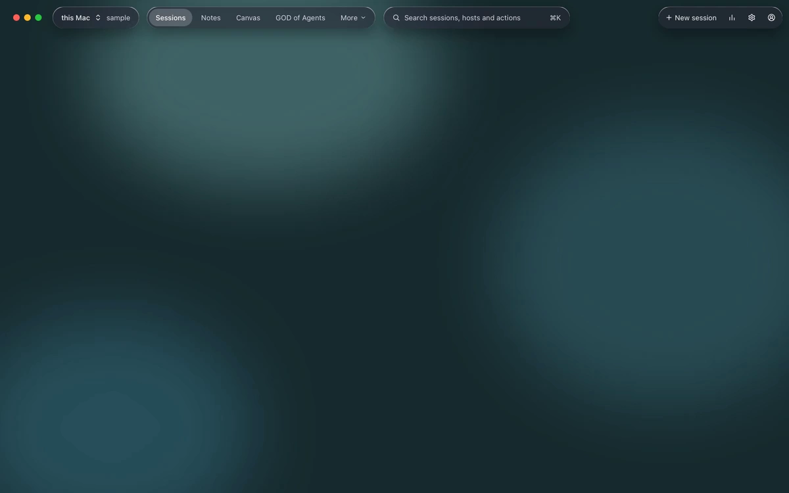
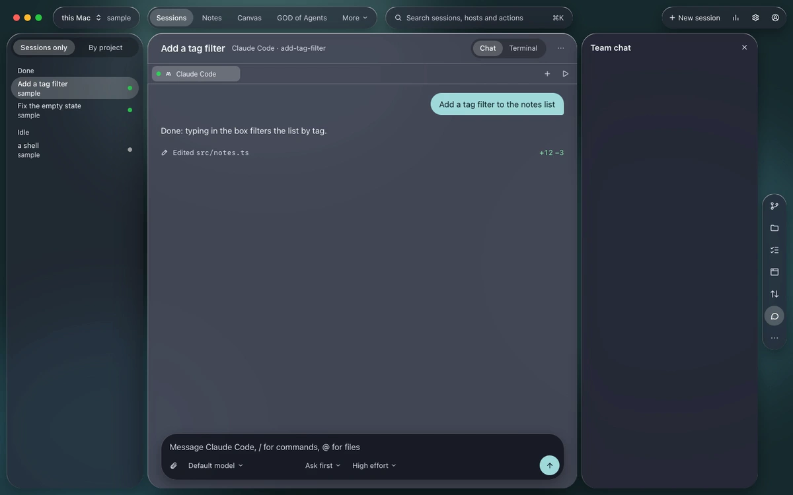

<p align="center">
  
</p>

<h1 align="center">enowX</h1>

<p align="center">
  enowX is a native desktop app to run and manage multiple AI coding agents, such as Claude Code, Codex and OpenCode, in parallel, on your machine or your own server.<br>
  <strong>Local-first, no telemetry. A team cloud only when you want one.</strong>
</p>

<p align="center">
  <a href="docs/install.md">Install</a> ·
  <a href="#what-it-does">Features</a> ·
  <a href="docs/agents.md">Agents</a> ·
  <a href="docs/cli.md">Command line</a> ·
  <a href="#documentation">Documentation</a> ·
  <a href="https://discord.gg/y8NVRnz8jh">Discord</a> ·
  <a href="LICENSE">MIT License</a>
</p>

<p align="center">
  
</p>

<sub>First-run setup's style step, from its design, with a sample conversation. It isn't a recording of the app.</sub>

> **Download:** [the latest release](https://github.com/enowdev/enowx/releases/latest) for macOS, Windows and Linux. Not yet signed or notarized, see [docs/install.md](docs/install.md) to open it. It updates itself.



<sub>This clip and the ones below are designs made on an enowX canvas with sample content. They are not recordings of the app: the sessions, files and results in them are made up.</sub>

## Why I built it

My laptop is a modest one. Building a Tauri app (a Rust compile, a dev server, a webview) while two or three coding agents work beside it was enough to make it crawl: every agent is a process of its own holding hundreds of megabytes, every build wants every core, and the fan spins all day. Buying a bigger laptop for this felt wrong when a server with more cores and memory costs a few dollars a month.

So enowX lets the heavy work run somewhere else while it still feels like it runs here:

- **The work runs on your server, the laptop only shows it.** Agents, builds and dev servers run on a server you own; the app on the laptop draws their terminals, chats, diffs and browser previews. Closing the laptop doesn't stop them, and they come back after the server reboots.
- **It stays usable on a weak machine.** The app is native, written entirely in Go with [MyGo](https://mygo.egoist.dev/), not a browser bundled as an app, so it stays light even with many sessions open, and idle agents hibernate to give their memory back.
- **Even desktop apps.** A Tauri, Electron or GTK app an agent builds on the server opens on your laptop's screen, in a window of its own, live.
- **Far servers feel close.** Connections reconnect by themselves and keepalives keep them open, so a server on another continent or a flaky Wi-Fi is fine.
- **Nothing is lost between machines.** Copy a project and its sessions to the server, work there, and sync files, commits and conversations back when you want them here.

### What's different

- **Your own server, no service in between.** Running agents remotely usually means someone else's cloud, an account or a relay. enowX connects to your machine and your servers directly over SSH (or Tailscale), with no account, no relay and no telemetry. Working with a team is opt-in: enowX Cloud shares notes, projects and hosts end-to-end encrypted, and nothing reaches it until you sign in.
- **Local and remote are the same.** The same daemon runs on your laptop and on the server; every feature works on both, and one app switches between them.
- **Any agent.** 45 agents built in, Claude Code and Codex the furthest integrated, and any other terminal program runs too. Several accounts of the same agent work side by side.
- **One-click servers.** A blank server gets your toolchains, git, gh, agents, skills and MCP servers in one step, or a new one is created at Hetzner, DigitalOcean, Vultr or InstaBox from the app.
- **All Go.** The app, its daemon and its command line are Go, the interface drawn with [MyGo](https://mygo.egoist.dev/), a native UI library for Go that needs no cgo: one binary per platform, and any machine builds it for macOS, Linux and Windows.
- **Parallel by design.** Every session is on its own branch in its own git worktree, so agents never overwrite each other, and one prompt can go to several agents to compare and keep the best.

## Contents

- [Why I built it](#why-i-built-it)
- [What it does](#what-it-does)
  - [Run agents in parallel](#run-agents-in-parallel)
  - [Let one agent run the others](#let-one-agent-run-the-others)
  - [Talk to them, in a terminal or a chat](#talk-to-them-in-a-terminal-or-a-chat)
  - [Review and ship](#review-and-ship)
  - [See it running](#see-it-running)
  - [Your laptop is just the screen](#your-laptop-is-just-the-screen)
  - [Desktop apps built on a server, used on your laptop](#desktop-apps-built-on-a-server-used-on-your-laptop)
  - [See and shape an app's HTTP](#see-and-shape-an-apps-http)
  - [Run mobile apps](#run-mobile-apps)
  - [Use your own model API](#use-your-own-model-api)
  - [Script it](#script-it)
  - [Make it yours](#make-it-yours)
  - [Work as a team](#work-as-a-team)
  - [Local-first](#local-first)
- [Agents](#agents)
- [Try it](#try-it)
- [Develop](#develop)
- [Documentation](#documentation)
- [Community](#community)

## What it does

### Run agents in parallel

Each session is an agent in a real terminal, on a branch of its own in a git worktree of its own, so agents never overwrite each other or your checkout. New worktrees get the project's `.env` and other ignored files it names, and run its setup script ([project-settings.md](docs/project-settings.md)).

- **45 agents built in**, each started the way it takes a first prompt, with its permission flags and its folder trusted. Any other terminal program runs too ([agents.md](docs/agents.md)).
- **Fan-out:** one prompt to several agents (or the same agent twice), then **Compare** what each changed and keep the best; the others are discarded with their worktrees and branches ([fan-out.md](docs/fan-out.md)).
- **Pipelines:** plan, implement and review a task, agents one after another, each stage starting from what the last ended with ([pipelines.md](docs/pipelines.md)).
- **Automations:** a prompt on a schedule, run by the host's daemon whether the app is open or not: weekday triage of new issues, a nightly dependency update ([automations.md](docs/automations.md)).
- **Agent accounts:** several accounts of Claude Code or Codex on a host, a work and a personal one say, picked per session with no new sign-in ([accounts.md](docs/accounts.md)).
- **Notes:** pages of notes on each host, nested like a notebook's and written a block at a time with Markdown's shortcuts and `/` for blocks: tabs, toggles, columns, callouts and cards, an outline to jump through, pictures pasted or added beside your text, undo and redo, and every version kept to restore. Groups and order your way, SVG icons (Lucide, Tabler, Phosphor or your own) in any color and size. **Ask an agent** beside a page (Claude Code, Codex or another, picked per note) tidies it, plans it or brainstorms it, its changes yours to accept. A note attaches to projects on any host, and an agent reads them all. Import from Notion (its export or its API, again on a schedule), Obsidian, Evernote, Keep or HTML, with their images; export to Markdown, folders, HTML, PDF or a backup ([notes.md](docs/notes.md)).
- **Canvas:** mockups in HTML, wireframes, diagrams and boards on each host, which you and agents design together on an endless board: scroll to move it, pinch to zoom, as in a design tool. Watch an agent build a design live, element by element, or ten variations to compare and star; click a component of a mockup to ask the agent about it, have it changed or redesigned, or leave a note on it; lay designs out on a grid; move and edit shapes, pause or stop the agent, restore versions; export PNG, SVG, PDF or HTML, link designs into working prototypes that share state; play and scrub motion, with anime.js and three.js built in; share a read-only link on your tailnet, and have an agent turn a design into code in a project, pixel for pixel. Agents are held to designs no wider than their frame ([canvas.md](docs/canvas.md)).
- **Clone from Git:** paste a repository's address (https or SSH), pick the folder, and the host clones it with its own git credentials, progress shown, then opens it as a project; agents do it with `enowx-app project clone`.
- **Your order and groups:** drag projects and groups in the session list, or put projects in a group from their menu; the host keeps them, so every device shows the same list.
- **Side by side:** several sessions in one view (`Ctrl+Shift+L`), each with its terminal, chat and browser.
- **Dark, Light or System:** every palette in both, your accent kept; terminals stay dark.
- **Status from the agents' own hooks:** working, needs you, done; notifications and unread marks, with a sound of your choice for each (built in or your own), quiet hours and a count on the app's icon. Idle agents hibernate to free memory, or you hibernate one yourself (right-click), and they come back on their conversation; past conversations can be resumed.
- **Credential vault:** your logins to GitHub, clouds, hosting, databases, registries and AI APIs, encrypted on this device and lent to a session on any host only when you allow it, never shown to agents in the clear. Fill it from what the host's tools already keep, from a token you copy on the platform's page, or by signing in in the browser; git, gh, docker and ssh on a server then work without signing in there ([vault.md](docs/vault.md)).
- **Features on demand:** Settings → Features turns what agents are told about (Traffic, Android, Canvas, Notes, the vault…) on or off everywhere, per host, project or session, so their prompts stay short ([features.md](docs/features.md)).
- **Floating control:** a round panel over other apps' windows, summoned from anywhere by `⌘⇧Space` (`Ctrl+Shift+Space` on Windows and Linux), with six actions round its center button and a session menu to choose this PC or a VPS, its server and project, then a session and its status; off by default, and turned on in Settings → Floating control ([floating-control.md](docs/floating-control.md)).


### Let one agent run the others

**GOD of Agents** is one session you drive that handles every other session, on every host ([goa.md](docs/goa.md)):

- **Hands out the work:** it splits what you ask into tasks for each project's own session, queued when that one is busy. A new session starts only if the project has none, or you ask.
- **Told, not polling:** a worker's turn ending, a prompt, a startup dialog, a limit or a worker that isn't moving reaches it as a line, quoting what's asked. What can't be undone or spends money stays yours.
- **A board of tasks:** each with its project, path, session and the model it really ran on, chosen per prompt by the judge. Sessions open in tabs beside it.
- **Sets enowX up with you:** it carries the docs and a guide to every setting, and stops for your keys and your agreement.

**RAG** lets agents find a project's code, docs and notes by meaning, in SQLite or PostgreSQL, asking before a project's text goes to an embedder ([rag.md](docs/rag.md)). **Decisions** has a small model answer instead of guessing: a quiet session's state, approving a command, trimming long output, stopping a loop ([decide.md](docs/decide.md)). **Hooks** run on what happens in any agent, in one format ([hooks.md](docs/hooks.md)).

### Talk to them, in a terminal or a chat

Claude Code and Codex also show as a chat: their own transcript, with tool calls and diffs folded in, a message box with the model, permission mode and effort, and the context used. Edit a message and send it again. The terminal keeps running behind it for approvals and menus ([chat-view.md](docs/chat-view.md)).



### Review and ship

The **Git** tab of the side panel shows what the selected session changed against its base, file by file. From there: comments sent back to the agent, commit, push, pull request (`gh`) and merge, or discard the worktree. **Conflict radar** warns when another session changed the same files, and on which lines. Sessions can start from a GitHub issue ([review.md](docs/review.md)).





Files open in tabs where you can edit them, on any host: undo, find and replace, line numbers, and a choice to make when an agent changes the file under you ([side panel](docs/side-panel.md#files)).

The side panel's other tools: **Checks** (the commands that tell whether the work holds up, run in the session's folder), **Files** (browse, open, add from this device, rename, duplicate, delete), **Ports** (what the session listens on), **Activity**, the **Browser**, **Traffic** and **Android** ([side-panel.md](docs/side-panel.md)).

### See it running

The **Browser** shows the session's dev server in a native web view, with hot reload, an address bar, a design mode to point at an element and hand it to the agent, and screenshots. Agents can drive it themselves from the command line ([preview.md](docs/preview.md)). Desktop apps open on your screen too: [see below](#desktop-apps-built-on-a-server-used-on-your-laptop).


**Resource usage** shows the memory and CPU of every session, counting everything it started (language servers, MCP servers, dev servers); the title bar shows the totals and each agent's plan limits.


### Your laptop is just the screen

- **Your own servers, over SSH.** The app installs its daemon on the server, which runs as a systemd service: sessions keep running with the laptop closed and come back after a reboot ([daemon.md](docs/daemon.md)).
- **One-click setup** brings a blank server what this device has: system packages, toolchains at the same versions, git and gh, the agents and their sign-in ([setup.md](docs/setup.md)).
- **Sync environment** copies the agents' skills, subagents, commands, memory files, settings and MCP servers between this device and a server, in either direction ([sync.md](docs/sync.md)).
- **Create a server** at Hetzner, DigitalOcean, Vultr or InstaBox from the app, with your own account and token, or connect to an InstaBox machine you have ([vps.md](docs/vps.md)).
- **Copy a project** and its sessions to another host: this machine to a server, a server to this machine, or between servers ([transfer.md](docs/transfer.md)).
- **Sync a project back**, both ways, with its copy on another host: files, commits, sessions and Claude Code's conversations, what changed on both sides since the last sync yours to pick ([transfer.md](docs/transfer.md#syncing-back)).
- **Keep copies in sync on their own** on a schedule or as files change, conflicts kept both ways and announced, and **push the work to a branch of its own** on GitHub (never your branch, secrets refused) ([transfer.md](docs/transfer.md)).
- **Your data on every host:** notes, canvases, settings and the vault (encrypted) are the same on this device and every server, merged when changed on two at once, conflicts kept for you to pick ([user-data-sync.md](docs/user-data-sync.md)).
- **Far servers stay connected:** connections come back by themselves, and keepalives keep them open. Tailscale is built in.

### Desktop apps built on a server, used on your laptop

An agent can build a desktop app on your server, and you use it on your laptop as if it ran there, with the framework's own hot reload ([preview.md](docs/preview.md#desktop-apps-with-windows-on-a-linux-server)).

- **Run with a display** in the New session dialog gives the session a virtual display of its own on the server, with [Xpra](https://xpra.org). Whatever the session runs opens its windows there: `tauri dev`, `npm run electron:dev`, `flutter run -d linux`, `cargo run`, a GTK or Qt app.
- **The app shows in a native window on your laptop**: enowX opens it with the app's first window, titles it as the app titles its own, and resizing it resizes the app. Keyboard and pointer go back to the server, and the clipboard follows.
- **Hot reload stays the framework's:** the agent changes a file on the server, the app reloads there, and the window on your laptop follows. While the app restarts the window hides, and it comes back with the new build.
- **Agents know how:** a session started without a display gets one when it runs `eval "$("$ENOWX_BIN" display)"`, and the agents enowX starts are told to do so before running a desktop app.
- **Missing Xpra?** The dialog says so and **Install Xpra** installs it with the server's package manager.
- **For web frontends** (Tauri, Electron and Wails serve theirs from a dev server), the Browser previews it with hot reload, no display needed.

Every frame crosses the network, so latency shows; most servers have no GPU, so 3D is slow; there is no audio. Linux servers only.

### See and shape an app's HTTP

The **Traffic** tool shows what the apps a session runs send and receive, on its host, live, over TLS too: requests, responses, WebSocket, server-sent events and gRPC ([traffic.md](docs/traffic.md)).

- **Attach what you want caught:** a new terminal, an open tab, the session's new tabs, the Browser tool's previews, Chrome, Edge, Brave or Firefox on a fresh profile, an Electron app, Docker containers, an Android device. Each host has its own certificate authority; nothing is caught until attached.
- **Inspect** headers and bodies by kind, timings and TLS, filter by domain and subdomain, status, type, headers, body, size and time.
- **Mock, forward, change, slow, fail or pause** requests with rules kept in the project (`.enowx/traffic.json`): a mock from a request in one click, breakpoints to edit a request or a response before it goes on.
- **Pause or stop recording** whenever the list gets busy, or only what a filter matches, and resume from where it left off.
- **Compose** requests, copy them as curl, fetch, Python, Go, HTTPie or PowerShell, export and import HAR.
- **Agents use it too:** `enowx-app traffic list|show|watch|mock…`, and the same as MCP tools (`enowx-app mcp`), secrets masked.

### Run mobile apps

The **Android** tool runs the session's app (Flutter, Expo, React Native, Capacitor, NativePHP, Kotlin or Java) on an emulator or a phone, on the session's host or on your laptop for a project on a server ([android.md](docs/android.md)).

- **Its screen in the side panel**, to touch, swipe and type on, with Back, Home, Recent apps, the volume and Power; **Pop out** opens it in [scrcpy](https://github.com/Genymobile/scrcpy)'s own window at full speed. Its log, by level and the app's only, beside it.
- **Catch its traffic** in Traffic: emulators and rooted phones trust enowX's certificate authority by themselves, other phones get it in Downloads with Settings opened.
- **Agents test what they build on it:** they take screenshots, read the screen's controls, tap, swipe and type (`enowx-app android screenshot|controls|tap|type…`).
- **Set up Android** brings a host the JDK, the SDK, an emulator and a virtual phone; **+ Phone** connects one over Wi-Fi.

### Use your own model API

**Settings → Agents** lists all 45 agents, with what each takes or why it can't ([configs.md](docs/configs.md)), and points Claude Code, Codex, OpenCode, Gemini CLI, Qwen Code, Droid, Goose, Aider, Kimi, Mistral Vibe, Pi, Continue and more at an API of yours, per session where the agent can: a company gateway, OpenRouter, a local server ([agent-api.md](docs/agent-api.md)).

- **Written the way each agent takes it**, in its own settings: several models, and where the agent has them, vision, context window, output limit and reasoning effort for each.
- **Your settings backed up first**, every time; **Restore** puts them back as you had them, byte for byte.
- **Keys stay on the host:** the app only ever sees their last four characters. Agents can set it too (`enowx-app api`).

### Script it

The `enowx-app` command line talks to the host's daemon, for scripts and for agents that start other agents ([cli.md](docs/cli.md)):

```sh
id=$(enowx-app spawn --agent codex --branch fix/parser "Fix the parser's handling of empty lines")
enowx-app wait "$id"      # until the agent is done or asks something
enowx-app read "$id"      # what its screen shows
enowx-app send "$id" "Now add a test for it"
enowx-app spawn --agents claude,codex "Add a search box"   # a fan-out
enowx-app pipeline "Paginate the notes list"               # plan, implement, review
```

Also `ls`, `status`, `note`, `kill`, `attach`, `agents`, `projects`, `shells`, `notes`, `pipelines`, `automation`, `browser` to drive a session's Browser, `traffic`, `android`, `ports`, `run` for the project's commands, and `api` for model APIs: everything the side panel does.

**Every agent knows them.** Each agent enowX starts is told what it can use, the way it takes instructions (a flag, a rules file, a block of its instructions), not only Claude Code and Codex; and `enowx-app mcp` serves the same as MCP tools, screenshots as images ([agents.md](docs/agents.md#what-agents-are-told)).

### Make it yours

Four UI styles (Liquid Glass, Ledger, Tonal and Bento), palettes that tint any of them, any accent color, your own background image, and a command palette (`Ctrl+K`) for every session, host and action. Settings has the agents' library (skills, MCP servers, subagents, commands, instructions, settings and plugins, global or per project), what new sessions start with, the shell terminals start with (zsh, bash, fish, PowerShell, Git Bash, WSL…), agent accounts, environment variables every session gets (API keys, say), automations, and diagnostics ([settings.md](docs/settings.md)).



Closing the window keeps enowX in the menu bar or the notification area: its icon counts the sessions that need you, and a click lists them ([tray.md](docs/tray.md)). Discord shows what you work on, the project, branch and agent, as Rich Presence, which Settings turns off. The app updates itself with signed archives, or a delta from the running version ([updates.md](docs/updates.md)).

### Work as a team

enowX Cloud, opt-in, puts a team together around the same projects ([cloud.md](docs/cloud.md)):



- **Teams with GitHub sign-in**, owners, admins, members and viewers. An invite is a link that works in the browser too: someone without the app signs in and joins there, then downloads enowX and finds the team.
- **A team's space:** its notes and canvases, its projects as Git links (cloned in one click, found when you have them already), its kit of skills, commands, subagents, pipelines, automations and templates, and each project's rules for the agents.
- **Shared hosts** over Tailscale: a member sees the sessions of a host shared with the team, watches one live, asks to take it over, or starts their own there with their own agent account, never the host owner's credentials.
- **Team chat** in the side panel, with `@` to mention members, notes, canvases, projects and files; messages edit and delete.
- **End-to-end encrypted:** what a team shares is sealed with the team's key on its members' devices, so the cloud holds ciphertext only; credentials never go to it. An audit log and a recovery key for the team's keys come with it.

### Local-first

No account needed, no relay, no telemetry. The app talks to your machine and your servers directly; the team cloud is used only once you sign in to it, and only for what you share. Passwords and tokens stay in the system's keychain and the encrypted vault.

## Agents

Claude Code, Codex, OpenCode, Gemini CLI, Kiro CLI, Claude Agent Teams, OpenClaude, Grok, GitHub Copilot, OpenCode 2, MiMo Code, Ante, Trae, Muse, DeepSeek Harness, Qoder CLI, Qoder CLI China, ZCode, Pi, OMP, Prime Agent, Antigravity, Aider, Goose, Amp, Kilo Code, Crush, Auggie, Autohand Code, Cline, Codebuff, Freebuff, Command Code, Continue, Cursor, Droid, Kimi, Mistral Vibe, Qwen Code, Rovo Dev, Hermes, Devin, OpenClaw, CodeBuddy and Jcode.

Each starts the way it takes a first prompt, with its permission flags, continuing its last conversation when a session comes back, told what enowX gives it, and pointed at your own model API if you like. The ones installed on a host show in the New session dialog; the others offer their installer. How each is started, signed in and watched is in [agents.md](docs/agents.md).

## Try it

Requires Go 1.27+ and git.

```sh
make build
./bin/enowx                          # this machine; open a folder from the sidebar
./bin/enowx --project ~/code/my-app  # also open a folder as a project
./bin/enowx --remote user@host       # a server; enowX installs its daemon there
```

enowX keeps its state in `~/.enowx-app` and links its command line as `enowx-app` (Settings → App). Installers for macOS, Linux and Windows: [install.md](docs/install.md).

## Develop

```sh
make dev       # hot reload: Go changes rebuild and relaunch the app and its daemon
make test
make lint
make package   # installers for every platform, into dist/<version>
```

The interface is built with [MyGo](https://mygo.egoist.dev/) (its widgets, terminal and web view), the rest is plain Go. The Release workflow on GitHub Actions builds the installers too, each on its own system.

`make dev` runs apart from an installed enowX: its state lives in `~/.enowx-dev` (set `DEV_HOME` to change it), its command line is `enowx-app-dev`, its icon is blue, and it builds the server daemon from source when it installs one. See [AGENTS.md](AGENTS.md) for the layout and code rules, [CONTRIBUTING.md](CONTRIBUTING.md) to contribute, [docs/protocol.md](docs/protocol.md) for the daemon's protocol, and [docs/PLAN.md](docs/PLAN.md) for the plan.

## Documentation

| Start | Servers | Agents at work | Reviewing and previewing | Settings | Reference |
|---|---|---|---|---|---|
| [Getting started](docs/install.md) | [Creating a server](docs/vps.md) | [Fan-out](docs/fan-out.md) | [Review and merge](docs/review.md) | [Settings](docs/settings.md) | [Command line](docs/cli.md) |
| [Agent presets](docs/agents.md) | [Setting up a server](docs/setup.md) | [Pipelines](docs/pipelines.md) | [Side panel](docs/side-panel.md) | [A project's settings](docs/project-settings.md) | [The daemon](docs/daemon.md) |
| [Agent accounts](docs/accounts.md) | [Environment sync](docs/sync.md) | [Automations](docs/automations.md) | [Preview](docs/preview.md) | [Updates](docs/updates.md) | [Protocol](docs/protocol.md) |
| [Model APIs](docs/agent-api.md) | [Copying a project](docs/transfer.md) | [Chat view](docs/chat-view.md) | [Traffic](docs/traffic.md) | [The tray](docs/tray.md) | [Notes](docs/notes.md) |
| [Team cloud](docs/cloud.md) | | | [Android](docs/android.md) | [Floating control](docs/floating-control.md) | [Canvas](docs/canvas.md) |
| | | | | [Vault](docs/vault.md) | |

## Community

Ask questions and follow along on [Discord](https://discord.gg/y8NVRnz8jh).

## License

[MIT](LICENSE). Security issues: [SECURITY.md](SECURITY.md).
